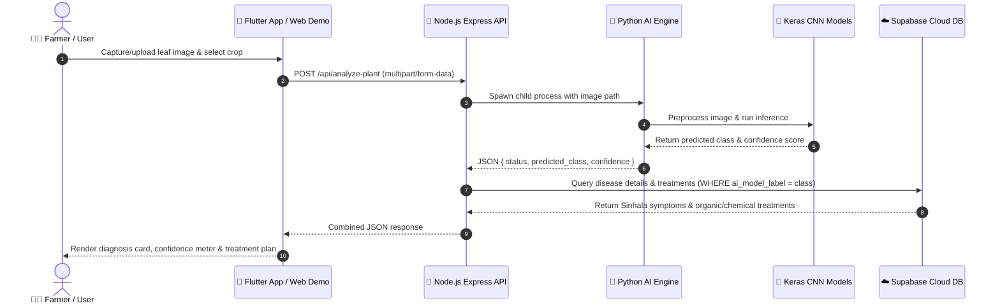

# 🌱 AgriCare LK

**AI-Powered Smart Plant Disease Detection and Agricultural Guidance System for Sri Lankan Farmers — in Sinhala 🇱🇰**

[](https://flutter.dev)
[](https://react.dev/)
[](https://vitejs.dev/)
[](https://nodejs.org)
[](https://www.tensorflow.org)
[](https://supabase.com)
[]()

---

## 📖 Overview

Smallholder farmers often lack immediate, affordable access to plant pathology experts when crop diseases strike. **AgriCare LK** solves this critical challenge by providing a complete smart agricultural ecosystem:

1. **Flutter Mobile Application**: An intuitive Android/iOS mobile app with 100% Sinhala-language interface, allowing farmers to take or upload leaf and fruit photos in the field.
2. **Interactive Web Showcase & Disease Encyclopedia**: A modern React/Vite web application featuring a live AI diagnostic simulator, comprehensive 22-class disease encyclopedia, interactive symptom guides, and direct APK download.
3. **Deep Learning AI Engines**: Dedicated Convolutional Neural Network (CNN) models trained on Tomato, Chili, and Brinjal (Eggplant) datasets to classify 22 distinct health conditions and diseases.
4. **Cloud & Fallback Database**: Powered by Supabase Cloud PostgreSQL with automated fallback to localized treatment guidelines (organic and chemical remedies, symptoms, and agricultural prevention tips in Sinhala).

---

## 📑 Table of Contents

- [✨ Features](#-features)
- [🏗 System Architecture](#-system-architecture)
- [🛠 Tech Stack](#-tech-stack)
- [📂 Project Structure](#-project-structure)
- [🌾 Supported Crops & Diseases](#-supported-crops--diseases)
- [🚀 Getting Started](#-getting-started)
  - [Prerequisites](#prerequisites)
  - [1. Backend Setup (Node.js & Supabase)](#1-backend-setup-nodejs--supabase)
  - [2. Interactive Web Showcase Setup (React + Vite)](#2-interactive-web-showcase-setup-react--vite)
  - [3. AI Models & Python Setup](#3-ai-models--python-setup)
  - [4. Mobile App Setup (Flutter)](#4-mobile-app-setup-flutter)
- [📡 API Reference](#-api-reference)
- [🗺 Roadmap](#-roadmap)
- [👤 Author](#-author)
- [📄 License](#-license)

---

## ✨ Features

- 📷 **Real-time Camera & Gallery Diagnosis**: Instant leaf/fruit disease detection directly from the field.
- 🧠 **Triple-Crop AI Models**: Custom deep learning models for **Tomato**, **Chili**, and **Brinjal** covering 22 health states and diseases.
- 🇱🇰 **100% Localized (Sinhala)**: Natural Sinhala language explanations for diseases, symptoms, organic treatments, and chemical solutions.
- 🌐 **Interactive Web Portal**: Showcase web application with interactive diagnosis demo, disease catalog, dynamic search, filters, and mobile phone mockups.
- ☁️ **Supabase Cloud Database**: Relational cloud backend storing disease symptoms and structured organic/chemical treatment steps.
- 🛡️ **Zero-Crash Resilience**: Built-in fallback knowledge base ensuring uninterrupted diagnosis even during offline/database downtime.

---

## 🏗 System Architecture



---

## 🛠 Tech Stack

| Component | Technologies |
|---|---|
| **Mobile App** | **Flutter 3.x (Dart)** — `image_picker`, `http`, responsive custom UI widgets |
| **Web Showcase** | **React 18, Vite 6, Tailwind CSS / Vanilla CSS** — Lucide icons, responsive layout |
| **Backend API** | **Node.js, Express 5** — Multer (multipart upload), CORS, Dotenv, `@supabase/supabase-js` |
| **Database** | **Supabase (Cloud PostgreSQL)** & Local Microsoft SQL Server script support |
| **Deep Learning** | **Python 3.9+, TensorFlow / Keras, OpenCV, NumPy** |

---

## 📂 Project Structure

```
AgriCare-LK/
├── agri_care_lk_web_app/      # React + Vite Interactive Web Showcase App
│   ├── public/                # Static assets, screenshots & disease sample images
│   ├── src/
│   │   ├── components/        # Hero, LiveAIDemo, DiseaseEncyclopedia, etc.
│   │   ├── data/              # Disease information and screenshots catalog
│   │   ├── App.jsx            # Main showcase app container
│   │   └── index.css          # Styling & animations
│   ├── package.json
│   └── vite.config.js
│
├── agricare_app/              # Flutter mobile application
│   ├── assets/                # App icon and visual assets
│   ├── lib/
│   │   ├── models/            # Data models
│   │   ├── screens/           # Home, Result, and Info screens
│   │   ├── services/          # HTTP API service client
│   │   └── widgets/           # UI components
│   └── pubspec.yaml
│
├── backend/                   # Node.js / Express API server
│   ├── server.js              # Express API with Supabase integration & child process spawning
│   ├── .env.example           # Supabase environment variables template
│   ├── restore_database.js    # Local SQL Server restore helper
│   └── package.json
│
├── predict_api.py             # Inference script for Tomato disease model
├── predict_chili.py           # Inference script for Chili disease model
├── predict_brinjal.py         # Inference script for Brinjal disease model
├── predict_disease.py         # Local visual test script with OpenCV / Matplotlib
├── train_model.py             # Tomato CNN model training script
├── train_chili_model.py       # Chili CNN model training script
├── train_brinjal_model.py     # Brinjal CNN model training script
├── supabase_setup.sql         # Supabase PostgreSQL schema and seed data (22 diseases)
├── setup_database.sql         # Local SQL Server schema and seed data
├── test_supabase.py           # Verification script for Supabase connection
├── test_db.py                 # Verification script for local SQL Server connection
└── README.md
```

---

## 🌾 Supported Crops & Diseases

The system diagnoses **22 distinct classes** across three major economic crops in Sri Lanka:

| Crop | Class Label | Condition / Disease (English) | නම (සිංහල) |
|---|---|---|---|
| 🍅 **Tomato** | `Tomato___Bacterial_spot` | Bacterial Spot | බැක්ටීරියා ලප රෝගය |
| 🍅 **Tomato** | `Tomato___Early_blight` | Early Blight | අංගමාරය (මුල්) |
| 🍅 **Tomato** | `Tomato___Late_blight` | Late Blight | පසු අංගමාරය |
| 🍅 **Tomato** | `Tomato___Leaf_Mold` | Leaf Mold | පත්‍ර පුස් රෝගය |
| 🍅 **Tomato** | `Tomato___Septoria_leaf_spot` | Septoria Leaf Spot | සෙප්ටෝරියා පත්‍ර ලප |
| 🍅 **Tomato** | `Tomato___Spider_mites Two-spotted_spider_mite` | Two-Spotted Spider Mite | රතු මයිටා හානිය |
| 🍅 **Tomato** | `Tomato___Target_Spot` | Target Spot | ඉලක්ක ලප රෝගය |
| 🍅 **Tomato** | `Tomato___Tomato_Yellow_Leaf_Curl_Virus` | Yellow Leaf Curl Virus | කහ පත්‍ර කොඩවීම |
| 🍅 **Tomato** | `Tomato___Tomato_mosaic_virus` | Mosaic Virus | මොසයික් වෛරසය |
| 🍅 **Tomato** | `Tomato___healthy` | Healthy Leaf | නිරෝගී තක්කාලි පත්‍රයක් |
| 🌶️ **Chili** | `Chili__leaf curl` | Leaf Curl | කොළ කොඩවීම |
| 🌶️ **Chili** | `Chili__leaf spot` | Leaf Spot | පත්‍ර ලප රෝගය |
| 🌶️ **Chili** | `Chili__whitefly` | Whitefly Infestation | සුදු මැස්සාගේ හානිය |
| 🌶️ **Chili** | `Chili__yellowish` | Yellowish Leaf | පත්‍ර කහවීම |
| 🌶️ **Chili** | `Chili__fruit rot` | Anthracnose / Fruit Rot | කරල් කුණුවීම (ඇන්ත්‍රැක්නෝස්) |
| 🌶️ **Chili** | `Chili__healthy` | Healthy Leaf | නිරෝගී මිරිස් පත්‍රයක් |
| 🌶️ **Chili** | `Chili__fruit healthy` | Healthy Fruit | නිරෝගී මිරිස් කරලක් |
| 🍆 **Brinjal** | `Brinjal_shoot_and_fruit_borer` | Shoot and Fruit Borer | කරටි සහ ගෙඩි විදින පණුවා |
| 🍆 **Brinjal** | `Brinjal_fruit_cracking` | Fruit Cracking | ගෙඩි පිපිරීමේ රෝගය |
| 🍆 **Brinjal** | `Brinjal_phomopsis_blight` | Phomopsis Blight | ෆොමොප්සිස් අංගමාරය |
| 🍆 **Brinjal** | `Brinjal_wet_rot` | Wet Rot (Choanephora) | තෙත කුණුවීමේ රෝගය |
| 🍆 **Brinjal** | `Brinjal_healthy_fruit` | Healthy Fruit | නිරෝගී වම්බටු ගෙඩියක් |

---

## 🚀 Getting Started

### Prerequisites

- [Node.js](https://nodejs.org/) (v18+) & `npm`
- [Python 3.9+](https://www.python.org/) with `pip`
- [Flutter SDK](https://docs.flutter.dev/get-started/install) (v3.12+)

---

### 1. Backend Setup (Node.js & Supabase)

1. Navigate to the backend directory and install dependencies:
   ```bash
   cd backend
   npm install
   ```

2. Configure your environment variables in `backend/.env`:
   ```env
   SUPABASE_URL=https://your-project-ref.supabase.co
   SUPABASE_ANON_KEY=your-supabase-anon-key
   PORT=3000
   ```

3. Setup the database tables by executing `supabase_setup.sql` in your Supabase SQL Editor.

4. Start the backend API server:
   ```bash
   npm run dev
   # Server runs on http://localhost:3000
   ```

---

### 2. Interactive Web Showcase Setup (React + Vite)

1. Open a new terminal and navigate to the web app directory:
   ```bash
   cd agri_care_lk_web_app
   npm install
   ```

2. Start the Vite development server:
   ```bash
   npm run dev
   # Web App opens at http://localhost:5173
   ```

---

### 3. AI Models & Python Setup

1. Install required Python packages:
   ```bash
   pip install tensorflow opencv-python numpy matplotlib
   ```

2. Train the models or place pre-trained `.keras` files in the root folder:
   - `tomato_disease_model.keras`
   - `chili_disease_model.keras`
   - `brinjal_disease_model.keras`

3. Verify Supabase connectivity and AI scripts:
   ```bash
   python test_supabase.py
   ```

---

### 4. Mobile App Setup (Flutter)

1. Navigate to the Flutter app directory:
   ```bash
   cd agricare_app
   flutter pub get
   ```

2. Update `lib/services/api_service.dart` with your machine's LAN IP or deployed backend URL:
   ```dart
   static const String baseUrl = 'http://192.168.1.100:3000/api';
   ```

3. Run the app on your connected device / emulator:
   ```bash
   flutter run
   ```

---

## 📡 API Reference

### `POST /api/analyze-plant`
Diagnoses an uploaded plant image using the specified crop model.

- **URL**: `http://localhost:3000/api/analyze-plant`
- **Method**: `POST`
- **Content-Type**: `multipart/form-data`

**Body:**
| Key | Type | Description |
|---|---|---|
| `image` | File | Crop photo (leaf or fruit) |
| `plantType` | String | `tomato` \| `chili` \| `brinjal` (default: `tomato`) |

**Sample Response (`200 OK`):**
```json
{
  "CommonName_EN": "Phomopsis Blight of Brinjal",
  "CommonName_SI": "වම්බටු ෆොමොප්සිස් අංගමාරය (Phomopsis Blight)",
  "Symptoms_SI": "පත්‍ර මත දුඹුරු පැහැති වටකුරු ලප ඇතිවීම, ගෙඩි මත ගිලුණු දුඹුරු පැහැති කුණුවීම් ඇතිවීම සහ ශාකය පරවී යාම.",
  "AI_Label": "Brinjal_phomopsis_blight",
  "confidence": 0.965,
  "treatments": [
    {
      "treatment_type": "Organic",
      "instruction_si": "රෝගී පත්‍ර සහ කුණු වූ ගෙඩි වහාම කඩා ඉවත් කර ගිනිතබන්න. බෝග පරිවර්තනය (Crop Rotation) අනුගමනය කරන්න."
    },
    {
      "treatment_type": "Chemical",
      "instruction_si": "කැප්ටාන් (Captan) හෝ මැන්කොසෙබ් (Mancozeb) දිලීර නාශකය නිර්දේශිත සාන්ද්‍රණයෙන් ස්ප්‍රේ කරන්න."
    }
  ]
}
```

---

## 🗺 Roadmap

- [x] Integrate Supabase Cloud Database for real-time treatment updates
- [x] Launch Interactive Web Showcase & Disease Encyclopedia
- [ ] Export TensorFlow Lite (`.tflite`) models for fully offline mobile inference
- [ ] Add voice-assisted diagnosis in Sinhala for enhanced accessibility
- [ ] Expand disease detection to Paddy (Rice), Coconut, and Tea crops

---

## 👤 Author

**Umindu Dinal**  
IT Undergraduate, Institute of Technology, University of Moratuwa (ITUM)  
GitHub: [@umindudinal](https://github.com/umindudinal)

---

## 📄 License

This project is developed for educational and agricultural empowerment purposes. All rights reserved.
