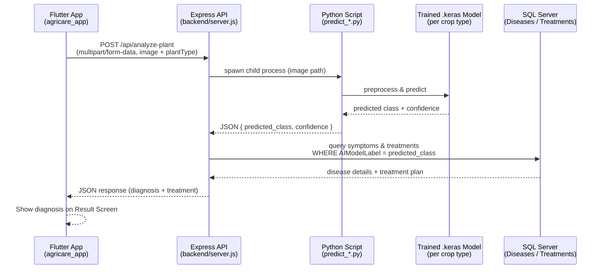

# 🌱 AgriCare LK

**AI-powered plant disease detection and treatment guidance for Sri Lankan farmers.**


AgriCare LK is a full-stack mobile application that helps farmers identify diseases in **Tomato**, **Chili**, and **Brinjal (Eggplant)** crops from a single photo. The app uses trained deep learning models to classify the disease and returns localized (Sinhala) treatment recommendations, symptoms, and agricultural tips sourced from a structured database.

---

## 📖 Table of Contents

- [Overview](#-overview)
- [Features](#-features)
- [System Architecture](#-system-architecture)
- [Tech Stack](#-tech-stack)
- [Project Structure](#-project-structure)
- [Getting Started](#-getting-started)
  - [Prerequisites](#prerequisites)
  - [1. Backend Setup (Node.js API)](#1-backend-setup-nodejs-api)
  - [2. Database Setup](#2-database-setup)
  - [3. AI Model Setup (Python)](#3-ai-model-setup-python)
  - [4. Mobile App Setup (Flutter)](#4-mobile-app-setup-flutter)
- [API Reference](#-api-reference)
- [Supported Crops & Diseases](#-supported-crops--diseases)
- [Roadmap](#-roadmap)
- [Contributing](#-contributing)
- [Author](#-author)
- [License](#-license)

---

## 🔍 Overview

Smallholder farmers often lack quick, affordable access to plant pathology expertise. AgriCare LK closes that gap by letting a farmer photograph an affected leaf or fruit and instantly receive:

1. The predicted disease (via an image sent to a trained CNN model)
2. A confidence score
3. Localized symptom descriptions and treatment instructions in Sinhala, pulled from a relational database

The system is built as three cooperating components: a **Flutter mobile app** (capture & display), a **Node.js/Express API** (orchestration & data), and **Python/TensorFlow models** (inference).

## ✨ Features

- 📷 Capture or upload a plant image directly from the mobile app
- 🧠 Disease classification for **three crop types** — Tomato, Chili, and Brinjal — using dedicated trained models
- 🇱🇰 Sinhala-language symptoms, treatment instructions, and UI text for accessibility
- 💊 Treatment recommendations pulled from a normalized SQL Server database (`Diseases` ↔ `Treatments`)
- 🌾 Agricultural tips presented alongside diagnosis results
- ⚡ Simple REST API that bridges the mobile client and the Python inference scripts

## 🏗 System Architecture



**Flow:**
1. The user selects a crop type and captures/uploads a leaf or fruit photo in the Flutter app.
2. The image is sent to the Express API's `/api/analyze-plant` endpoint.
3. The API spawns the corresponding Python prediction script (`predict_api.py`, `predict_chili.py`, or `predict_brinjal.py`) as a child process.
4. The Python script loads the relevant `.keras` model, preprocesses the image, and returns the predicted class and confidence as JSON.
5. The API queries SQL Server for the matching disease's symptoms and treatment plan and returns a combined JSON payload.
6. The Flutter app renders the diagnosis, symptoms, and treatment on the result screen.

## 🛠 Tech Stack

| Layer | Technology |
|---|---|
| Mobile App | **Flutter (Dart)** — `image_picker`, `http`; builds for Android, iOS, Web, Windows, Linux, macOS |
| Backend API | **Node.js (JavaScript)** — Express 5, Multer, CORS |
| Machine Learning | **Python** — TensorFlow / Keras, OpenCV, NumPy |
| Database | **Microsoft SQL Server** (via `mssql` / `msnodesqlv8`) |
| Model Training | Python, TensorFlow, Google Colab / local GPU |

**Languages used in this repository:** Dart (mobile app UI/logic), JavaScript (backend API), Python (ML training & inference), C++/CMake/Swift/Kotlin/Objective-C/C (auto-generated Flutter platform build files for Windows/Linux/macOS/iOS/Android), HTML (Flutter web build).

## 📁 Project Structure

```
AgriCare-LK/
├── agricare_app/            # Flutter mobile application
│   ├── lib/
│   │   ├── main.dart
│   │   ├── models/           # Data models (e.g. disease_model.dart)
│   │   ├── screens/          # home_screen, result_screen, info_screen
│   │   ├── services/         # api_service.dart — HTTP client for the backend
│   │   └── widgets/          # Reusable UI components
│   └── pubspec.yaml
├── backend/                 # Node.js / Express API
│   ├── server.js             # Main API server, image upload & orchestration
│   └── package.json
├── predict_api.py           # Tomato disease inference script
├── predict_chili.py         # Chili disease inference script
├── predict_brinjal.py       # Brinjal disease inference script
├── predict_disease.py       # Standalone tomato inference/demo script (matplotlib preview)
├── train_model.py           # Tomato model training script
├── train_chili_model.py     # Chili model training script
├── train_brinjal_model.py   # Brinjal model training script
├── test_db.py                # Database connectivity test script
└── README.md
```

## 🚀 Getting Started

### Prerequisites

Make sure the following are installed on your machine:

- [Node.js](https://nodejs.org/) (v18+) and npm
- [Python](https://www.python.org/) 3.9+ with `pip`
- [Flutter SDK](https://docs.flutter.dev/get-started/install) (3.12+)
- Microsoft SQL Server (Express edition works) + **ODBC Driver 17 for SQL Server**
- Python packages: `tensorflow`, `opencv-python`, `numpy`, `matplotlib`

Install the Python dependencies:

```bash
pip install tensorflow opencv-python numpy matplotlib
```

### 1. Backend Setup (Node.js API)

```bash
cd backend
npm install
```

Update the SQL Server connection string in `server.js` to match your environment:

```js
const connectionString = "Driver={ODBC Driver 17 for SQL Server};Server=YOUR_SERVER\\SQLEXPRESS;Database=AgriCareLK_DB;Trusted_Connection=yes;";
```

Start the API server:

```bash
npm run dev     # with nodemon (auto-reload)
# or
npm start
```

The API will run on the port configured in `server.js`.

### 2. Database Setup

Create a SQL Server database named `AgriCareLK_DB` with (at minimum) the following tables:

- **`Diseases`** — `DiseaseID`, `AIModelLabel`, `CommonName_EN`, `CommonName_SI`, `Symptoms_SI`
- **`Treatments`** — `DiseaseID` (FK), `TreatmentType`, `Instruction_SI`

The `AIModelLabel` column must match the exact class labels used by the trained models (e.g. `Tomato___Early_blight`, `Chili__leaf spot`, `Brinjal_phomopsis_blight`) so the API can join a prediction to its treatment record.

You can verify your connection using:

```bash
python test_db.py
```

### 3. AI Model Setup (Python)

Train each crop's model (or supply your own pre-trained `.keras` files in the project root):

```bash
python train_model.py            # Tomato model  -> tomato_disease_model.keras
python train_chili_model.py      # Chili model   -> chili_disease_model.keras
python train_brinjal_model.py    # Brinjal model -> brinjal_disease_model.keras
```

> **Note:** Trained model files (`.keras`) are not committed to this repository due to size. Train locally/via Colab or place your model files in the project root before starting the backend.

### 4. Mobile App Setup (Flutter)

```bash
cd agricare_app
flutter pub get
flutter run
```

Point the app's API base URL (in `lib/services/api_service.dart`) to your backend server's address (e.g. `http://<your-local-ip>:<port>/api`).

## 📡 API Reference

### `POST /api/analyze-plant`

Analyzes a plant image and returns the predicted disease with treatment details.

**Request:** `multipart/form-data`

| Field | Type | Required | Description |
|---|---|---|---|
| `image` | file | ✅ | Photo of the affected leaf/fruit |
| `plantType` | string | optional | `tomato` (default) \| `chili` \| `brinjal` |

**Response:** `200 OK`

```json
{
  "CommonName_EN": "Early Blight",
  "CommonName_SI": "...",
  "Symptoms_SI": "...",
  "AI_Label": "Tomato___Early_blight",
  "confidence": 0.94,
  "treatments": [ { "TreatmentType": "...", "Instruction_SI": "..." } ]
}
```

**Error responses:** `400` (no image provided), `500` (AI inference or database error).

## 🌾 Supported Crops & Diseases

| Crop | Classes |
|---|---|
| **Tomato** | Bacterial Spot, Early Blight, Late Blight, Leaf Mold, Septoria Leaf Spot, Spider Mites, Target Spot, Yellow Leaf Curl Virus, Mosaic Virus, Healthy |
| **Chili** | Leaf Curl, Leaf Spot, Whitefly, Yellowish, Fruit Rot, Healthy (leaf & fruit) |
| **Brinjal** | Fruit Cracking, Phomopsis Blight, Shoot & Fruit Borer, Wet Rot, Healthy Fruit |

## 🗺 Roadmap

- [ ] Package and version trained models via Git LFS or cloud storage
- [ ] Add offline/on-device inference (TensorFlow Lite) for low-connectivity areas
- [ ] Expand crop coverage beyond Tomato, Chili, and Brinjal
- [ ] Add English translations alongside Sinhala content
- [ ] Deploy the backend API to a cloud host with a managed SQL database

## 🤝 Contributing

Contributions, issue reports, and feature suggestions are welcome. Please open an issue or submit a pull request.

## 👤 Author

**Umindu**
IT Undergraduate, Institute of Technology, University of Moratuwa (ITUM)
GitHub: [@umindudinal](https://github.com/umindudinal)

## 📄 License

This project currently has no license file. Add a `LICENSE` file to define usage terms, or contact the author for permissions.
