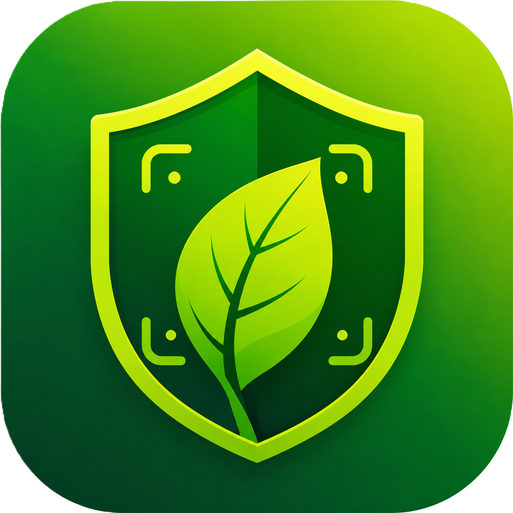
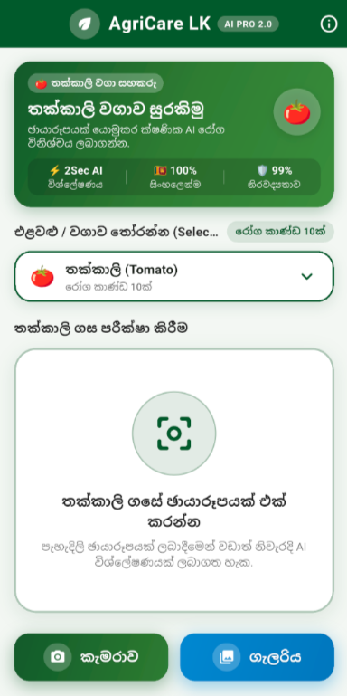
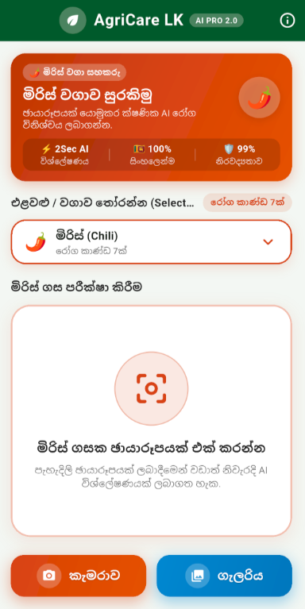
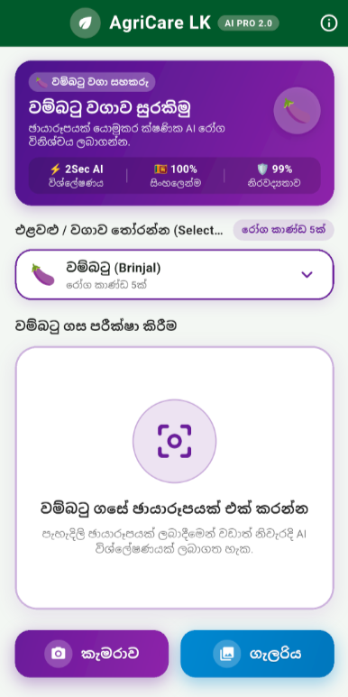
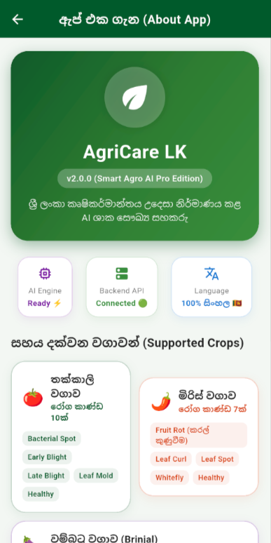
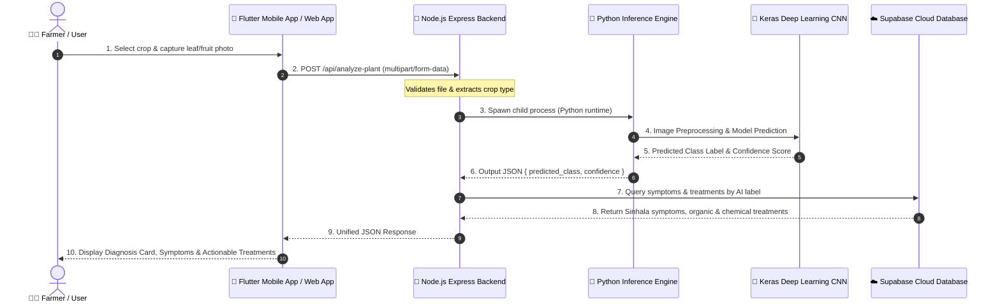

<div align="center">

  

  # 🌿 AgriCare LK
  ### **AI-Powered Plant Disease Diagnosis & Agricultural Guidance System for Sri Lanka**

  <p align="center">
    <strong>Empowering Sri Lankan farmers with instant, photo-based crop disease diagnosis, organic remedies, and chemical treatment guidelines in 100% Sinhala.</strong>
  </p>

  <p align="center">
    <a href="#-key-features">Features</a> •
    <a href="#-app-screenshots">Screenshots</a> •
    <a href="#-system-architecture">Architecture</a> •
    <a href="#-supported-crops--diseases">Crop Matrix</a> •
    <a href="#-quickstart-guide">Quickstart</a> •
    <a href="#-api-documentation">API Docs</a> •
    <a href="#-author">Author</a>
  </p>

  <p align="center">
    
    
    
    
    
    
    
    
  </p>

</div>

---

## 📌 Problem & Vision

In Sri Lanka, agricultural productivity is frequently threatened by crop diseases and pest infestations. Smallholder farmers often struggle with:
- **Delayed diagnosis**: Limited access to agricultural extension officers in remote farming communities.
- **Language barriers**: Technical chemical labels and scientific literature that are not easily accessible in native Sinhala.
- **Indiscriminate chemical usage**: Over-application of pesticides due to uncertain diagnoses, degrading soil health and increasing production costs.

**AgriCare LK** bridges this gap by delivering a **smart AI-driven crop doctor directly to farmers' smartphones**. With a simple photo of an infected leaf or fruit, the system instantly identifies the condition with high confidence and offers step-by-step **organic solutions** and **targeted chemical treatments** in clear Sinhala.

---

## ✨ Key Features

| Feature | Description |
|---|---|
| 📷 **Instant Photo Diagnosis** | Capture leaves or fruits using the smartphone camera or pick from the gallery for real-time classification. |
| 🧠 **Triple-Crop AI Engines** | Dedicated Deep Learning CNN models for **Tomato**, **Chili**, and **Brinjal** covering **22 distinct classes**. |
| 🇱🇰 **100% Sinhala Localization** | Complete UI, symptom descriptions, and actionable treatment instructions in native Sinhala. |
| 💊 **Dual Treatment Guidance** | Provides both **eco-friendly organic methods** (compost, neem oil, pheromone traps) and **regulated chemical prescriptions**. |
| ☁️ **Supabase Cloud Database** | Scalable PostgreSQL cloud database for live symptom updates and dynamic disease catalogs. |
| 🛡️ **Zero-Crash Fail-Safe** | Built-in offline fallback knowledge base ensuring uninterrupted diagnosis even during network/database outages. |
| 🌐 **Interactive Web Portal** | Companion React + Vite web showcase with live diagnostic simulator, screenshot gallery, and interactive encyclopedia. |

---

## 📱 App Screenshots

<div align="center">
  <table>
    <tr>
      <th align="center">🍅 Tomato Diagnosis</th>
      <th align="center">🌶️ Chili Diagnosis</th>
      <th align="center">🍆 Brinjal Diagnosis</th>
      <th align="center">📖 Guidance & Tips</th>
    </tr>
    <tr>
      <td></td>
      <td></td>
      <td></td>
      <td></td>
    </tr>
  </table>
</div>

---

## 🏗 System Architecture



---

## 🌾 Supported Crops & Diseases (22 Classes)

AgriCare LK accurately diagnoses **22 disease classes and healthy conditions** across 3 major agricultural crops in Sri Lanka:

### 🍅 Tomato (*Solanum lycopersicum*)
| AI Class Label | Disease Name (English) | රෝග නම (Sinhala) | Symptoms Summary |
|---|---|---|---|
| `Tomato___Bacterial_spot` | Bacterial Spot | බැක්ටීරියා ලප රෝගය | Dark, water-soaked leaf spots with yellow halos |
| `Tomato___Early_blight` | Early Blight | අංගමාරය (මුල්) | Concentric target-like brown rings on older leaves |
| `Tomato___Late_blight` | Late Blight | පසු අංගමාරය | Pale green to brown water-soaked lesions with white mold |
| `Tomato___Leaf_Mold` | Leaf Mold | පත්‍ර පුස් රෝගය | Pale green/yellow spots with olive-green velvety mold underneath |
| `Tomato___Septoria_leaf_spot` | Septoria Leaf Spot | සෙප්ටෝරියා පත්‍ර ලප | Small circular spots with dark brown margins and grey centers |
| `Tomato___Spider_mites Two-spotted_spider_mite` | Two-Spotted Spider Mite | රතු මයිටා හානිය | Yellow stippling, leaf bronzing, and fine webbing |
| `Tomato___Target_Spot` | Target Spot | ඉලක්ක ලප රෝගය | Brown lesions with concentric rings causing premature defoliation |
| `Tomato___Tomato_Yellow_Leaf_Curl_Virus` | Yellow Leaf Curl Virus | කහ පත්‍ර කොඩවීම | Stunted growth, upward leaf curling, and yellow leaf margins |
| `Tomato___Tomato_mosaic_virus` | Mosaic Virus | මොසයික් වෛරසය | Mottling with alternating light/dark green patches and distortion |
| `Tomato___healthy` | Healthy Leaf | නිරෝගී තක්කාලි පත්‍රයක් | Vibrant green leaf free of spots, discoloration, or pests |

### 🌶️ Chili (*Capsicum annuum*)
| AI Class Label | Disease Name (English) | රෝග නම (Sinhala) | Symptoms Summary |
|---|---|---|---|
| `Chili__leaf curl` | Leaf Curl Virus | කොළ කොඩවීම | Severe upward or downward curling, puckering, and stunting |
| `Chili__leaf spot` | Cercospora Leaf Spot | පත්‍ර ලප රෝගය | Circular brown spots with light grey centers on leaves |
| `Chili__whitefly` | Whitefly Infestation | සුදු මැස්සාගේ හානිය | Yellowing leaves, sticky honeydew, and sooty mold growth |
| `Chili__yellowish` | Nutrient Deficiency / Yellowing | පත්‍ර කහවීම | General chlorosis, pale leaves due to nitrogen/micro-nutrient lack |
| `Chili__fruit rot` | Anthracnose / Fruit Rot | කරල් කුණුවීම (ඇන්ත්‍රැක්නෝස්) | Sunken circular spots on fruits with concentric fungal rings |
| `Chili__healthy` | Healthy Leaf | නිරෝගී මිරිස් පත්‍රයක් | Lush green leaf without lesions or insect damage |
| `Chili__fruit healthy` | Healthy Fruit | නිරෝගී මිරිස් කරලක් | Firm, smooth, unblemished chili pod |

### 🍆 Brinjal / Eggplant (*Solanum melongena*)
| AI Class Label | Disease Name (English) | රෝග නම (Sinhala) | Symptoms Summary |
|---|---|---|---|
| `Brinjal_shoot_and_fruit_borer` | Shoot and Fruit Borer | කරටි සහ ගෙඩි විදින පණුවා | Drooping shoots with bore holes and larval frass on fruits |
| `Brinjal_fruit_cracking` | Fruit Cracking | ගෙඩි පිපිරීමේ රෝගය | Surface splitting and longitudinal cracks due to boron/water stress |
| `Brinjal_phomopsis_blight` | Phomopsis Blight | ෆොමොප්සිස් අංගමාරය | Circular brown leaf spots and sunken rotting lesions on fruits |
| `Brinjal_wet_rot` | Wet Rot (Choanephora) | තෙත කුණුවීමේ රෝගය | Wet blossom and fruit rot covered with whisker-like black fungal heads |
| `Brinjal_healthy_fruit` | Healthy Fruit | නිරෝගී වම්බටු ගෙඩියක් | Glossy, firm, unblemished brinjal fruit |

---

## 🛠 Tech Stack Deep Dive

```
┌────────────────────────────────────────────────────────────────────────┐
│                          PRESENTATION LAYER                            │
│   📱 Flutter Mobile App (Dart)       🌐 React 18 + Vite 6 Showcase    │
└───────────────────────────────────┬────────────────────────────────────┘
                                    │ HTTP / REST
┌───────────────────────────────────▼────────────────────────────────────┐
│                           API GATEWAY LAYER                            │
│   Node.js + Express 5  •  Multer Multipart  •  CORS  •  Dotenv         │
└───────────────┬────────────────────────────────────────┬───────────────┘
                │ IPC Child Process                      │ REST / HTTPS
┌───────────────▼────────────────┐      ┌────────────────▼───────────────┐
│       AI INFERENCE LAYER       │      │        DATABASE LAYER          │
│  Python 3.9+                   │      │  Supabase Cloud (PostgreSQL)   │
│  TensorFlow / Keras CNNs       │      │  Normalized Schema:            │
│  OpenCV (CV2) & NumPy          │      │  - diseases table              │
│  MobileNetV2 / Transfer Models │      │  - treatments table            │
└────────────────────────────────┘      └────────────────────────────────┘
```

---

## 📂 Repository Organization

```
AgriCare-LK/
├── agricare_app/                   # Flutter Mobile Application
│   ├── assets/                     # App icon and graphical assets
│   ├── lib/
│   │   ├── main.dart               # App entry point & theme setup
│   │   ├── models/                 # Disease and treatment Dart models
│   │   ├── screens/
│   │   │   ├── home_screen.dart    # Camera/Gallery photo picker & crop selector
│   │   │   ├── result_screen.dart  # Diagnosis presentation, meters & Sinhala remedies
│   │   │   └── info_screen.dart    # Agricultural advice and app information
│   │   ├── services/
│   │   │   └── api_service.dart    # HTTP communication with backend API
│   │   └── widgets/                # Reusable UI cards, badges, and meters
│   └── pubspec.yaml                # Flutter dependencies
│
├── agri_care_lk_web_app/           # Interactive Web Showcase App (React + Vite)
│   ├── public/                     # Icons, screenshots, and 22 disease sample images
│   ├── src/
│   │   ├── components/             # Hero, LiveAIDemo, DiseaseEncyclopedia, FAQ, etc.
│   │   ├── data/                   # Disease descriptions and screenshot datasets
│   │   ├── App.jsx                 # Showcase layout container
│   │   └── index.css               # Modern styling and animations
│   ├── package.json
│   └── vite.config.js
│
├── backend/                        # Node.js Express API Server
│   ├── server.js                   # Main API orchestration & Supabase client
│   ├── .env.example                # Template for environment configuration
│   ├── restore_database.js         # Local SQL Server migration helper
│   └── package.json
│
├── predict_api.py                  # Python inference runner for Tomato model
├── predict_chili.py                # Python inference runner for Chili model
├── predict_brinjal.py              # Python inference runner for Brinjal model
├── predict_disease.py              # Standalone local test script with Matplotlib
├── train_model.py                  # Training pipeline for Tomato CNN model
├── train_chili_model.py            # Training pipeline for Chili CNN model
├── train_brinjal_model.py          # Training pipeline for Brinjal CNN model
├── supabase_setup.sql              # Supabase PostgreSQL DDL schema & seed records
├── setup_database.sql              # Local SQL Server DDL schema & seed records
├── test_supabase.py                # Verification script for Supabase connection
├── test_db.py                      # Verification script for SQL Server connection
├── .gitignore                      # Git ignore rules for datasets, models & secrets
└── README.md                       # Project documentation
```

---

## 🚀 Quickstart Guide

### 📋 Prerequisites
Make sure you have the following installed on your development machine:
- **Node.js** (v18.0 or higher) and `npm`
- **Python** (v3.9 or higher) with `pip`
- **Flutter SDK** (v3.12 or higher)
- **Git**

---

### Step 1: Clone the Repository

```bash
git clone https://github.com/umindudinal/AgriCare-LK.git
cd AgriCare-LK
```

---

### Step 2: Backend API & Supabase Setup

1. **Install backend dependencies:**
   ```bash
   cd backend
   npm install
   ```

2. **Configure environment variables:**
   Create a `.env` file in the `backend/` directory:
   ```env
   PORT=3000
   SUPABASE_URL=https://your-project-id.supabase.co
   SUPABASE_ANON_KEY=your-supabase-anon-key
   ```

3. **Deploy the Database Schema:**
   - Go to your [Supabase Dashboard](https://supabase.com/dashboard) → **SQL Editor**.
   - Copy the contents of [`supabase_setup.sql`](supabase_setup.sql) and execute the query.
   - This creates the `diseases` and `treatments` tables and populates all 22 classes.

4. **Start the API Server:**
   ```bash
   npm run dev
   # API will be live at: http://localhost:3000
   ```

---

### Step 3: Python Environment & Deep Learning Models

1. **Create and activate a virtual environment:**
   ```bash
   python -m venv .venv
   # Windows:
   .venv\Scripts\activate
   # macOS/Linux:
   source .venv/bin/activate
   ```

2. **Install ML dependencies:**
   ```bash
   pip install tensorflow opencv-python numpy matplotlib
   ```

3. **Train or Place Pre-Trained Model Files:**
   Ensure the following model files exist in the project root:
   - `tomato_disease_model.keras`
   - `chili_disease_model.keras`
   - `brinjal_disease_model.keras`

   *(You can train your own models anytime using `python train_model.py`, `python train_chili_model.py`, and `python train_brinjal_model.py`)*

4. **Verify Database Connection:**
   ```bash
   python test_supabase.py
   ```

---

### Step 4: Launch the Companion Web Showcase (React + Vite)

```bash
cd agri_care_lk_web_app
npm install
npm run dev
# Showcase Portal runs on: http://localhost:5173
```

---

### Step 5: Run the Flutter Mobile Application

1. **Navigate to the Flutter directory and fetch packages:**
   ```bash
   cd agricare_app
   flutter pub get
   ```

2. **Set the Backend Endpoint:**
   In [`agricare_app/lib/services/api_service.dart`](agricare_app/lib/services/api_service.dart), update the IP address to your machine's local LAN IP:
   ```dart
   static const String baseUrl = 'http://192.168.1.100:3000/api';
   ```

3. **Launch on an Android/iOS Device or Emulator:**
   ```bash
   flutter run
   ```

---

## 📡 API Documentation

### 1. Plant Disease Analysis Endpoint
Processes an uploaded image through the deep learning model and retrieves localized treatments from the database.

- **Endpoint**: `POST /api/analyze-plant`
- **Content-Type**: `multipart/form-data`

#### Parameters:
| Field | Type | Required | Description |
|---|---|---|---|
| `image` | `File` | ✅ Yes | Image file of the plant leaf or fruit (`.jpg`, `.jpeg`, `.png`) |
| `plantType` | `String` | ❌ Optional | Target crop: `tomato` (default), `chili`, or `brinjal` |

#### Sample Request (`curl`):
```bash
curl -X POST http://localhost:3000/api/analyze-plant \
  -F "image=@/path/to/leaf_sample.jpg" \
  -F "plantType=tomato"
```

#### Sample Response (`200 OK`):
```json
{
  "CommonName_EN": "Early Blight",
  "CommonName_SI": "අංගමාරය (මුල්) - Early Blight",
  "Symptoms_SI": "පහළ පත්‍ර වල දුඹුරු පැහැති වෘත්තාකාර ලප ඇතිවීම සහ පසුව මුළු පත්‍රයම කහ වී හැලී යාම.",
  "AI_Label": "Tomato___Early_blight",
  "confidence": 0.978,
  "treatments": [
    {
      "treatment_type": "Organic",
      "instruction_si": "රෝගී පත්‍ර කපා ඉවත් කර ක්ෂේත්‍රයෙන් බැහැරව ගිනිබත් කරන්න. කොහොඹ ඇට සාරය (50g/L) හෝ ට්‍රයිකෝඩර්මා (Trichoderma) මිශ්‍රණය දින 7කට වරක් යොදන්න."
    },
    {
      "treatment_type": "Chemical",
      "instruction_si": "මැන්කොසෙබ් 80% WP (Mancozeb - 10L ට 30g) හෝ ක්ලොරෝතැලෝනිල් 500g/L SC (10L ට 25ml) දින 7-10 ක පරතරයකින් පත්‍ර වලට හොඳින් ස්ප්‍රේ කරන්න."
    }
  ]
}
```

---

### 2. Disease Catalog Endpoint
Retrieves the full list of catalogued diseases and treatment procedures.

- **Endpoint**: `GET /api/diseases`
- **Response**: List of all 22 diseases with corresponding organic and chemical prescriptions.

---

### 3. Server Health Check
- **Endpoint**: `GET /`
- **Response**: `{ "status": "online", "message": "🌿 AgriCare LK API Server is running smoothly..." }`

---

## 🗺 Roadmap & Future Enhancements

- [x] **Supabase Cloud Migration**: Real-time cloud database replacing local-only SQL servers.
- [x] **Interactive Web Showcase**: Full React + Vite companion web app with live AI simulator.
- [ ] **On-Device Edge AI (TFLite)**: Export quantized `.tflite` models for zero-connectivity offline diagnosis.
- [ ] **Voice-Assisted UI in Sinhala**: Speech-to-text and voice guidance for elderly and non-tech-savvy farmers.
- [ ] **Expanded Crop Portfolio**: Add models for **Paddy (Rice)**, **Coconut**, **Tea**, and **Cabbage**.
- [ ] **Weather & Pest Early Warning System**: Hyper-local weather forecasting with disease risk warnings.

---

## 🤝 Contributing

Contributions make the open-source community an inspiring place to learn, inspire, and create. Any contributions you make are **greatly appreciated**!

1. Fork the Project (`https://github.com/umindudinal/AgriCare-LK/fork`)
2. Create your Feature Branch (`git checkout -b feature/AmazingFeature`)
3. Commit your Changes (`git commit -m 'Add some AmazingFeature'`)
4. Push to the Branch (`git push origin feature/AmazingFeature`)
5. Open a Pull Request

---

## 👤 Author

<div align="center">
  <h3><strong>Umindu Dinal</strong></h3>
  <p>Undergraduate in Information Technology<br/>Institute of Technology, University of Moratuwa (ITUM), Sri Lanka</p>

  <p>
    <a href="https://github.com/umindudinal"></a>
  </p>
</div>

---

## 📄 License

This project is open-source and available under the terms of the **MIT License**.

<div align="center">
  <sub>Built with ❤️ for Sri Lankan Agriculture & Farming Communities 🇱🇰</sub>
</div>
